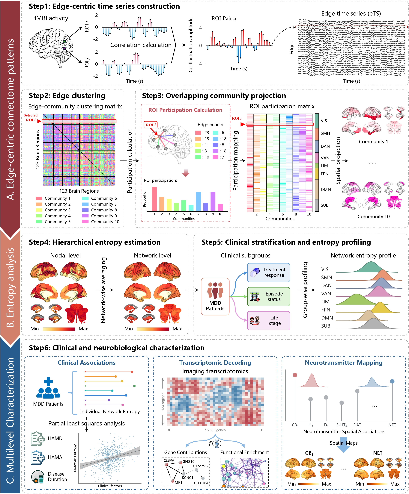
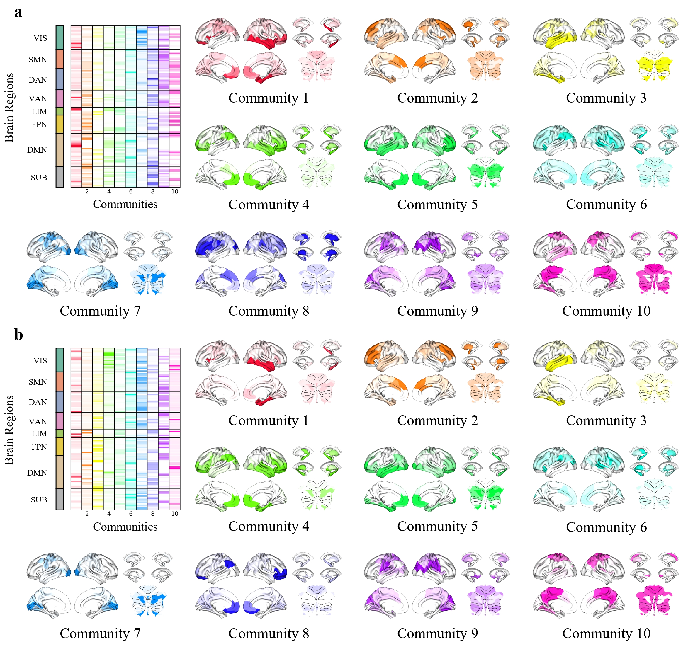

# Edge-centric MDD Clinical Heterogeneity

**Paper:** *Edge-centric connectome patterns of clinical heterogeneity in major depressive disorder: Associations with transcriptomic and neurotransmitter profiles*

<p align="center">
<a href="https://github.com/ZHChen-294">Zhihong Chen</a><sup>1</sup>,
Xian Mo<sup>2</sup>,
Mengfan Li<sup>3</sup>,
Minhui Bai<sup>1</sup>,
Jiayi Peng<sup>4</sup>,
Xiaorui Han<sup>5</sup>,
Mengfan Wang<sup>5</sup>,
Jiang Wu<sup>1</sup>,
Li Pu<sup>1</sup>,
Zhengze Gong<sup>6</sup>,
Qinyu Lv<sup>7</sup>,
Zhenghui Yi<sup>7</sup>,
<a href="https://www.cd120.com/expertlist/detail/53536.html">Wei Zhang</a><sup>2,8,*</sup>,
<a href="https://scholar.google.com.hk/citations?user=ClUoWqsAAAAJ&hl=zh-CN&oi=ao">Dezhong Yao</a><sup>1,*</sup>,
and
<a href="https://scholar.google.com.hk/citations?user=KJqKYq4AAAAJ&hl=zh-CN">Hongmei Yan</a><sup>1,*</sup>
</p>

<details>
<summary><strong>Author affiliations</strong></summary>

<sup>1</sup> The Clinical Hospital of Chengdu Brain Science Institute, Sichuan Institute for Brain Science and Brain-Inspired Intelligence, School of Life Science and Technology, University of Electronic Science and Technology of China, Chengdu, 610054, Sichuan, China

<sup>2</sup> West China Biomedical Big Data Center, West China Hospital, Sichuan University, Chengdu, 610041, Sichuan, China

<sup>3</sup> Department of Medical Engineering, Xijing 986 Hospital, Fourth Military Medical University, Xian, 710054, Shaanxi, China

<sup>4</sup> Department of Radiology, Sichuan Provincial People’s Hospital, University of Electronic Science and Technology of China, Chengdu, 610072, Sichuan, China

<sup>5</sup> Department of Radiology, Guangzhou First People’s Hospital, School of Medicine, South China University of Technology, Guangzhou, 510180, Guangdong, China

<sup>6</sup> Information and Data Center, Guangzhou First People’s Hospital, School of Medicine, South China University of Technology, Guangzhou, 510180, Guangdong, China

<sup>7</sup> Shanghai Mental Health Center, Shanghai Jiao Tong University School of Medicine, 200122, Shanghai, China

<sup>8</sup> Mental Health Center and Psychiatric Laboratory, the State Key Laboratory of Biotherapy, West China Hospital, Sichuan University, Chengdu, 610041, Sichuan, China

<sup>*</sup> Corresponding authors.

</details>

---

## Overview

This repository provides the core **edge-centric connectome implementation** and **K = 10 group community templates** accompanying our study of major depressive disorder (MDD).

The implementation includes:

- Edge time series (eTS) construction.
- K-means clustering of edges into functional communities.
- ROI community participation.
- Nodal entropy and network entropy.
- Hungarian alignment of community identities.
- ROI and functional-network mappings.

The shared community data correspond to the author-confirmed plotting inputs for **Figure 2C–D**, including MDD and healthy control (HC) templates.

This release focuses on the core edge-centric methods and community data. It does not include the complete group-statistical, clinical, transcriptomic, or neurotransmitter analysis pipelines.

## Study overview

<p align="center">
  
</p>

## Functional communities

<p align="center">
  
</p>

(A) Ten functional communities identified in the MDD group. (B) Ten corresponding communities in the HC group. Community labels are aligned across groups for direct comparison.

The ten communities describe edge-community organization. Their spatial maps show each ROI’s participation in individual communities, rather than ten mutually exclusive anatomical parcels.

## Repository structure

```text
.
├── README.md
├── requirements.txt
├── provenance.json
├── checksums.sha256
├── edgecentric/
│   ├── __init__.py
│   ├── timeseries.py
│   ├── clustering.py
│   ├── metrics.py
│   ├── alignment.py
│   └── atlas.py
├── atlas/
│   ├── roi_mapping.csv
│   └── roi_atlas.nii.gz
├── communities/
│   ├── README.md
│   ├── group_communities_k10.npz
│   ├── MDD_community_participation.nii.gz
│   └── HC_community_participation.nii.gz
└── Img/
    ├── Framework.jpg
    └── Community.jpg
```

## Installation

Requires **Python 3.10 or later**.

```bash
git clone https://github.com/ZHChen-294/Edge-centric-mdd-decoding.git
cd Edge-centric-mdd-decoding
pip install -r requirements.txt
```

Core dependencies are NumPy, SciPy, and scikit-learn. The pinned versions describe the code-extraction environment, rather than a recovered historical analysis environment.

Run the examples from the repository root. NIfTI files can be opened with standard neuroimaging viewers. Reading them in Python additionally requires `nibabel`.

## Quick start

### Load the shared community data

```python
import numpy as np
from edgecentric import edge_label_matrix

with np.load(
    "communities/group_communities_k10.npz",
    allow_pickle=False,
) as data:
    groups = data["group_names"]           # MDD, HC
    participation = data["participation"]  # (2, 123, 10)
    edge_labels = data["edge_labels"]      # (2, 7503), IDs 1–10
    roi_ids = data["roi_ids"]              # Native atlas labels 1–123

mdd_participation = participation[0]
hc_participation = participation[1]

mdd_edge_matrix = edge_label_matrix(
    edge_labels[0],
    label_base=1,
)
```

HC community IDs are already aligned to the MDD reference. Do not apply an additional arbitrary relabelling to the distributed templates.

### Compute eTS and entropy for your own data

The input must contain **already preprocessed, covariate-regressed, and z-scored ROI time series**, arranged as `(123, n_timepoints)` in the supplied native ROI order.

```python
import numpy as np
from edgecentric import (
    build_ets,
    cluster_edges,
    participation,
    nodal_entropy,
    network_entropy,
    load_roi_mapping,
)

# Replace this path with your own preprocessed ROI time-series file.
bold = np.load("your_preprocessed_roi_timeseries.npy")

ets = build_ets(bold)                         # (n_timepoints, 7503)
labels, inertia = cluster_edges(
    ets,
    k=10,
    level="individual",
)                                            # Labels: 0–9

roi_participation = participation(labels)      # (123, 10)
H, H_bits, counts = nodal_entropy(labels)       # (123,), (123,), (123, 10)

network_ids = np.array([
    int(row["network_id"])
    for row in load_roi_mapping()
])
H_network = network_entropy(H, network_ids)    # (8,)
```

`build_ets` does not perform preprocessing or additional standardization.

### Align newly computed communities

```python
from edgecentric import align_communities

aligned_hc, old_to_new, aligned_hc_labels = align_communities(
    reference=mdd_participation,
    target=hc_participation,
    edge_labels=None,
)
```

Matching minimizes the correlation distance between ROI participation columns. The returned mapping follows `old_to_new[old_id] = new_id` and uses **zero-based indices**.

New K-means solutions have arbitrary community labels and require explicit alignment before comparing community identities.

## Methods and parameters

### Edge time series

For standardized ROI signals \(z_i(t)\) and \(z_j(t)\):

\[
e_{ij}(t) = z_i(t)z_j(t).
\]

Edges follow NumPy’s strict upper-triangle order:

```python
np.triu_indices(123, k=1)
```

This gives **7,503 undirected edges**.

### Edge-community clustering

The selected study setting is **K = 10**. Clustering is applied to `ets.T`, so edges are observations and time points are features.

| Setting | Individual-level clustering | Group-level clustering |
|---|---|---|
| Initialization | k-means++ | k-means++ |
| `n_init` | 25 | 10 |
| `max_iter` | 1000 | Estimator default: 300 |
| `random_state` | None | 42 |

For group-level clustering, `average_ets` temporally z-scores each subject’s edge time series before averaging. Its output can be passed to:

```python
cluster_edges(group_average, k=10, level="group")
```

`average_ets` returns both the average and the accepted array count; arrays with incompatible shapes are skipped. Individual and group-level inputs should not be interchanged.

## ROI and network definitions

The HybridAtlas contains **123 ROIs** in the following native order:

| ROI IDs | Component |
|---|---|
| 1–16 | Tian S1 subcortical parcels |
| 17–116 | Schaefer100 cortical parcels |
| 117–123 | Buckner7 cerebellar network parcels |

Network order is:

**VIS, SMN, DAN, VAN, LIM, FPN, DMN, SUB**

The seven cerebellar parcels are assigned to their corresponding functional networks. **SUB contains the 16 subcortical ROIs only.**

Exact ROI names, network assignments, and voxel labels are provided in `atlas/`.

## Community data format

### NPZ

`communities/group_communities_k10.npz` contains:

| Array | Shape | Description |
|---|---|---|
| `participation` | `(2, 123, 10)` | Group ROI participation matrices |
| `edge_labels` | `(2, 7503)` | One-based community IDs |
| `edge_pairs` | `(7503, 2)` | Zero-based ROI index pairs |
| `group_names` | `(2,)` | MDD, HC |
| `roi_ids` / `roi_names` | `(123,)` each | Native ROI identifiers and names |
| `network_ids` | `(123,)` | Network IDs 1–8 |
| `network_names` | `(8,)` | Ordered network names |
| `community_ids` | `(10,)` | Community IDs 1–10 |
| `hc_to_mdd_mapping` | `(10,)` | Saved HC-to-MDD ID mapping |
| `metadata_json` | Scalar string | Definitions and spatial metadata |

The distributed HC mapping is the one-based identity mapping, 1→1 through 10→10, because its saved community columns are already aligned.

### NIfTI

Each group’s NIfTI has shape **`(97, 115, 97, 10)`** on the supplied **MNI152NLin2009cAsym, 2 mm HybridAtlas grid**.

- The fourth dimension indexes **Community 1–10**, not time.
- Each ROI contains its community participation value.
- Background voxels are zero.
- NIfTI values are stored as float32; NPZ retains the original participation precision.

The NIfTIs preserve unthresholded participation. Published surface rendering additionally applies percentile-based display scaling, low-value thresholding, and thalamic display merging. Consequently, NIfTI values should not be interpreted as rendered image intensities.

See [`communities/README.md`](communities/README.md) for details.

## Reproducibility and data availability

The release preserves the original core computation logic and selected K=10 setting. Interfaces, key parameters, saved arrays, and spatial mappings were checked during packaging; no clustering or complete analysis was rerun.

Individual K-means uses `random_state=None`, as in the original implementation. Exact historical cluster regeneration is therefore not guaranteed. Load the supplied templates directly when examining the reported group community organization.

Only group-level community data and atlas mappings are distributed. Raw fMRI time series, participant identifiers, and clinical records are not included.

Source references and fingerprints are recorded in `provenance.json`; file checksums are provided in `checksums.sha256`.

## Citation and attribution

If you use this code or the community data, please cite:

> Chen Z, et al. *Edge-centric connectome patterns of clinical heterogeneity in major depressive disorder: Associations with transcriptomic and neurotransmitter profiles.*

Please also acknowledge the original **Schaefer2018**, **Tian**, and **Buckner2011** atlas publications when using the supplied ROI mappings.

Publication details and a DOI will be added when available.

## License

A code and data license has not yet been specified. Third-party atlas components remain subject to their respective redistribution terms.

## Contact

For questions or reproducibility issues, please open a [GitHub issue](https://github.com/ZHChen-294/Edge-centric-mdd-decoding/issues).

